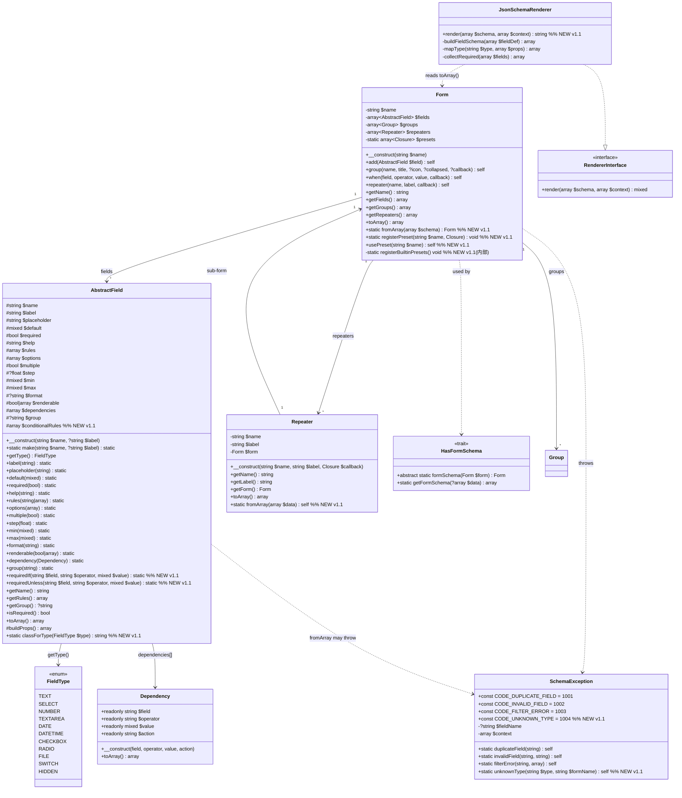
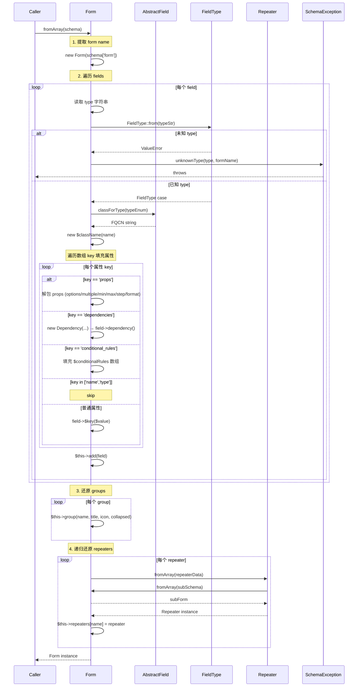
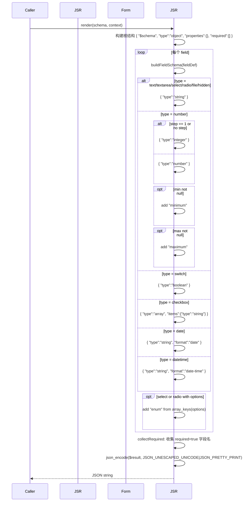
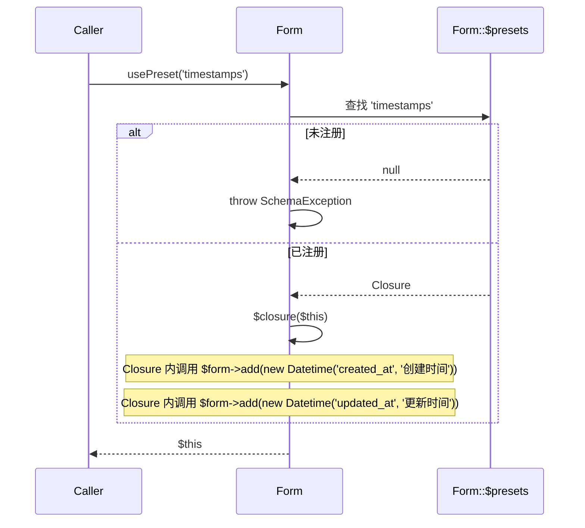
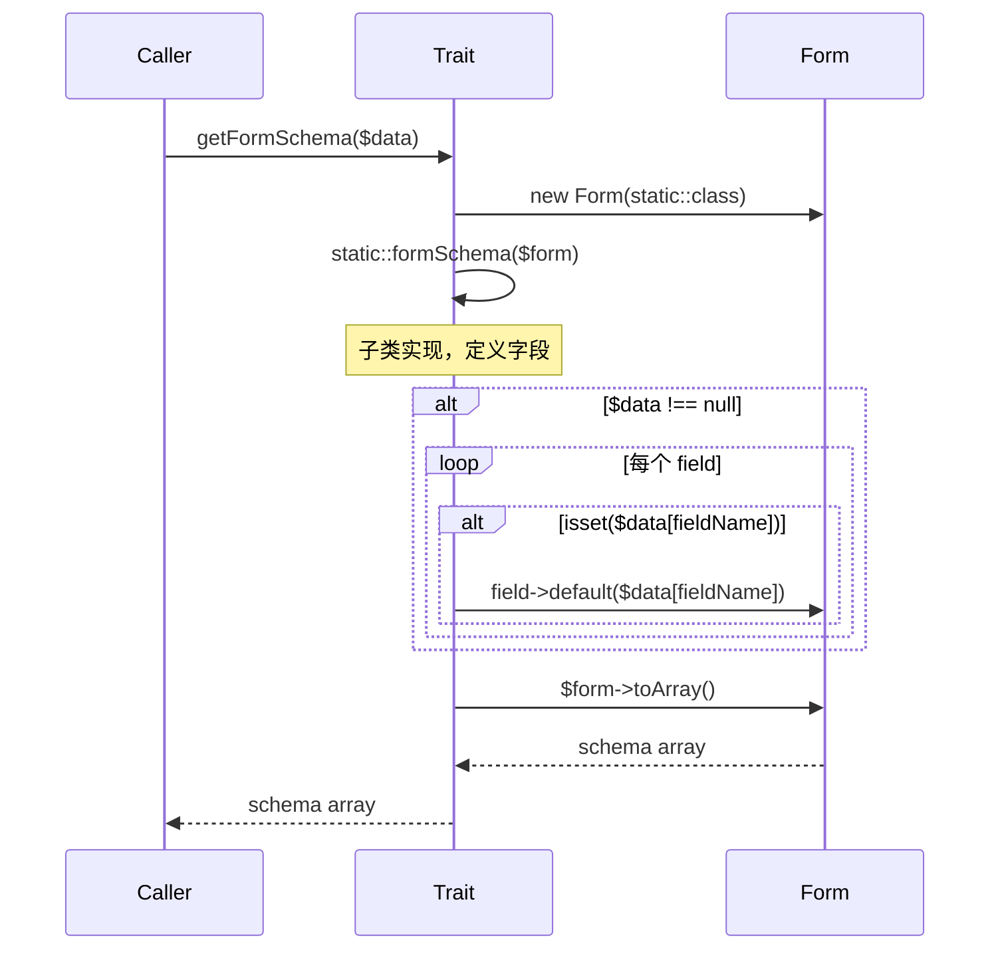
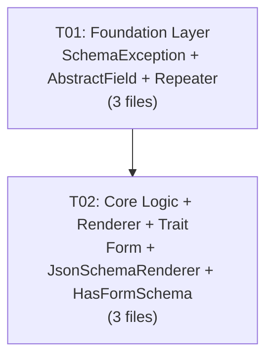

# System Design — wise-form-schema v1.1

> **Architect**: Bob  
> **Base**: v1.0（已实现 Form / AbstractField / 11 子类 / Dependency / Group / Repeater / ValidationGenerator / DataFilter / ArrayRenderer）  
> **Scope**: 增量 5 项功能，不重复已有设计  
> **⚠️ 历史快照（2026-09-22 注）**：本文是 v1.1 的**设计时**文档，其中「ValidationGenerator.php [不变]」等结论已过时。
> 该文件的规则名已从 Laravel 风格 `required` 改为 ThinkPHP 的 `require`，并新增了 `HtmlRenderer` 渲染层，
> 当前实现请以 `README.md` 与源码为准。

---

## Part A: System Design

### 1. Implementation Approach

#### 技术难点分析

| 难点 | 分析 | 策略 |
|------|------|------|
| **fromArray 反向重建** | toArray 输出丢失了 PHP 类型信息；需 `FieldType` 字符串 → 具体子类映射；Repeater 构造函数依赖 Closure 无法从数组直接重建 | 在 AbstractField 添加静态映射表 `FieldType → class-string`；Repeater 新增 `fromArray()` 静态工厂 |
| **conditional_rules 语义表达** | `requiredIf` / `requiredUnless` 需统一到同一 `conditional_rules` 数组，requiredUnless 的"除非"语义用 `operator='!='` 编码 | toArray 统一输出 `{rule, field, operator, value}` 结构；requiredUnless 忽略传入 operator，固定输出 `!=` |
| **JSON Schema 类型映射** | PHP 弱类型 → JSON Schema 严格类型；number step=1 映射 integer；checkbox 映射 `array<string>`；enum/minimum/maximum 约束需从 props 提取 | 逐字段 type-switch 映射，props 透传为约束 |
| **Field Presets 全局注册** | 静态注册表需支持 Closure 回调注入，usePreset 时回调接收当前 Form 实例 | 静态私有数组 `$presets` + `registerPreset` / `usePreset` |
| **HasFormSchema Trait** | 需要抽象方法约束 + 静态访问器注入 data 为 default | Trait 内 abstract static 方法（PHP 8.1 支持），getFormSchema 静态实现 |

#### 框架与库选择

- **零框架依赖**（延续 v1.0 约束）
- **PHP >= 8.1**：enum、readonly、named arguments、match 表达式、`static` 返回类型
- 无第三方 JSON Schema 库，JsonSchemaRenderer 手工构建，保证零依赖

#### 架构模式

- **值对象模式**：Dependency / Group 不变
- **Fluent API**：AbstractField 的 requiredIf / requiredUnless 延续 Fluent 链式风格
- **静态工厂**：Repeater::fromArray() 绕开 Closure 构造限制
- **Trait 模式**：HasFormSchema 提供可复用静态访问器
- **策略/渲染器模式**：JsonSchemaRenderer 实现 RendererInterface

---

### 2. File List

```
src/
├── Form.php                          # [修改] fromArray / registerPreset / usePreset / $presets / registerBuiltinPresets
├── Dependency.php                    # [不变]
├── DataFilter.php                    # [不变]
├── Group.php                         # [不变]
├── Repeater.php                      # [修改] 新增 static fromArray(array): self
├── ValidationGenerator.php           # [不变]
├── enums/
│   └── FieldType.php                 # [不变]
├── exception/
│   └── SchemaException.php           # [修改] 新增 CODE_UNKNOWN_TYPE / unknownType()
├── field/
│   ├── AbstractField.php             # [修改] requiredIf / requiredUnless / $conditionalRules / toArray 扩展 / classForType()
│   ├── Text.php                      # [不变]
│   ├── ... (其余 10 个子类)           # [不变]
├── renderer/
│   ├── RendererInterface.php         # [不变]
│   ├── ArrayRenderer.php             # [不变]
│   └── JsonSchemaRenderer.php        # [新增] 实现 RendererInterface，输出 JSON Schema Draft-07
└── trait/
    └── HasFormSchema.php             # [新增] Trait: formSchema() + getFormSchema()
```

**文件变更汇总**：新增 2 个，修改 4 个，不变 18 个。

---

### 3. Data Structures and Interfaces



---

### 4. Program Call Flow

#### 4.1 Form::fromArray — 反向重建流程



#### 4.2 JsonSchemaRenderer::render — JSON Schema 生成



#### 4.3 Form::usePreset — 预设加载



#### 4.4 HasFormSchema::getFormSchema — 数据注入



---

### 5. Anything UNCLEAR

以下已基于 PRD 中已决策项明确；如需确认请标示：

| 项目 | 假设/决策 | 风险 |
|------|-----------|------|
| **Repeater::fromArray** | 新增静态工厂方法，内部使用反射或新增 `setForm()` 包内方法 | 低 — 纯内部实现 |
| **Presets 初始化时机** | 内置预设通过 `registerBuiltinPresets()` 在类首次加载时注册；也可由调用方在 bootstrap 中显式调用 | 低 — 符合 PHP 静态初始化常规 |
| **HasFormSchema Form name** | `getFormSchema()` 中 `new Form(static::class)` 以完整类名作为 form name | 低 — 保持唯一性 |
| **JsonSchemaRenderer 顶层** | 顶层 type 固定 `"object"`，不构建 definitions/$ref | Q2 已确认 |
| **JsonSchemaRenderer required** | 仅基于 `field.required === true` 收集，不处理 conditional_rules 中的 required | 后续版本可扩展 |
| **number 类型整型判断** | `step == 1` 或 `step === null` 时映射 `"integer"`，其他映射 `"number"` | 假设 step=1 即整数步进 |
| **conditional_rules toArray** | 直接输出 `$this->conditionalRules` 数组，不做额外序列化 | 数组格式已标准化 |
| **requiredUnless operator 参数** | 接收 $operator 参数但输出固定为 `'!='`，参数保留用于语义自解释 | Q6 已确认 |

---

## Part B: Task Decomposition

### 6. Required Packages

无新增第三方依赖。PHP >= 8.1 标准库即可覆盖所有实现。

```
- (zero) 零框架依赖，延续 v1.0 约束
```

### 7. Task List (ordered by dependency)

**总计 2 个任务**，满足 ≤5 硬性上限，每个 ≥3 文件。

---

#### T01: Foundation Layer — Exception + AbstractField + Repeater

| 字段 | 内容 |
|------|------|
| **Task ID** | T01 |
| **Task Name** | 基础层变更：条件规则 + 未知类型异常 + Repeater 工厂 |
| **Source Files** | `src/exception/SchemaException.php`（修改）`src/field/AbstractField.php`（修改）`src/Repeater.php`（修改） |
| **Dependencies** | 无 |
| **Priority** | P0 |

**修改细节**：

**SchemaException.php**
- 新增常量 `CODE_UNKNOWN_TYPE = 1004`
- 新增静态工厂 `unknownType(string $type, string $formName): self`
  - 消息格式：`"Unknown field type \"$type\" in form \"$formName\"."`
  - 上下文携带 `['type' => $type, 'form' => $formName]`

**AbstractField.php**
- 新增属性 `protected array $conditionalRules = []`
- 新增 Fluent 方法 `requiredIf(string $field, string $operator, mixed $value): static`
  - `$this->conditionalRules[] = ['rule' => 'required', 'field' => $field, 'operator' => $operator, 'value' => $value]`
- 新增 Fluent 方法 `requiredUnless(string $field, string $operator, mixed $value): static`
  - `$this->conditionalRules[] = ['rule' => 'required', 'field' => $field, 'operator' => '!=', 'value' => $value]`
  - 注意：忽略传入的 `$operator`，固定输出 `'!='`
- 修改 `toArray()`：在返回数组中追加 `'conditional_rules' => $this->conditionalRules`
- 新增静态方法 `classForType(FieldType $type): string`
  - 返回 FieldType case → 具体子类 FQCN 的映射
  - 映射表：TEXT→Text, SELECT→Select, NUMBER→Number, TEXTAREA→Textarea, DATE→Date, DATETIME→Datetime, CHECKBOX→Checkbox, RADIO→Radio, FILE→File, SWITCH→SwitchField, HIDDEN→Hidden

**Repeater.php**
- 新增静态工厂 `public static function fromArray(array $data): self`
  - 从 `$data['name']` / `$data['label']` / `$data['fields']` 重建
  - 内部：`$instance = new self($name, $label, fn() => null)` + 反射注入 Form 或新增包内方法
  - **推荐实现**：新增 `private function setForm(Form $form): void`，fromArray 内调用之

---

#### T02: Form Core + Renderer + Trait

| 字段 | 内容 |
|------|------|
| **Task ID** | T02 |
| **Task Name** | 核心逻辑层：fromArray + Presets + JSON Schema Renderer + HasFormSchema |
| **Source Files** | `src/Form.php`（修改）`src/renderer/JsonSchemaRenderer.php`（新增）`src/trait/HasFormSchema.php`（新增） |
| **Dependencies** | T01（依赖 SchemaException::unknownType、AbstractField::classForType、Repeater::fromArray） |
| **Priority** | P0 |

**修改/新增细节**：

**Form.php 新增方法**
- `public static function fromArray(array $schema): self`
  - 算法见 §4.1 时序图
  - 关键步骤：
    1. `$form = new self($schema['form'])`
    2. foreach `$schema['fields']` → `FieldType::from(typeStr)` → `AbstractField::classForType(typeEnum)` → `new $class(name)` → 遍历填充属性 → `$form->add()`
    3. foreach `$schema['groups']` → `$form->group(...)`
    4. foreach `$schema['repeaters']` → `Repeater::fromArray($data)` → `$form->repeaters[$name] = $repeater`
    5. 返回 `$form`
  - 属性填充策略（遍历 field array key）：
    - `'name'` / `'type'` → skip
    - `'props'` → 解包子 key（options/multiple/min/max/step/format）调用对应 Fluent 方法
    - `'dependencies'` → 逐条 `new Dependency(...)` → `$field->dependency()`
    - `'conditional_rules'` → 直接赋值 `$conditionalRules`（通过反射或新增 setter）
    - 其他 key → `$field->$key($value)`（Fluent 方法名 = key）
  - 幂等性：fromArray→toArray 往返一致，`conditional_rules` 已加入 toArray

- `public static function registerPreset(string $name, Closure $callback): void`
  - 静态全局注册：`self::$presets[$name] = $callback`

- `public function usePreset(string $name): self`
  - 查找 `self::$presets[$name]`，未找到抛异常
  - `(self::$presets[$name])($this)`
  - 返回 `$this`

- `private static function registerBuiltinPresets(): void`
  - 注册 4 个内置预设：
    - **timestamps**: `created_at`(Datetime, label: '创建时间') + `updated_at`(Datetime, label: '更新时间')
    - **sortable**: `sort_order`(Number, default: 0, label: '排序') + `status`(Select, options: [1=>'启用',0=>'禁用'], label: '状态')
    - **softDelete**: `delete_time`(Datetime, label: '删除时间')
    - **userBasic**: `username`(Text, required, label: '用户名') + `email`(Text, label: '邮箱') + `phone`(Text, label: '手机号') + `avatar`(File, label: '头像')

- 新增静态属性 `private static array $presets = []`
- 在类定义底部或通过静态初始化触发 `registerBuiltinPresets()`

**JsonSchemaRenderer.php（新增）**
- 命名空间 `wise\form\schema\renderer`
- `implements RendererInterface`
- `public function render(array $schema, array $context = []): string`
  - 构建 `$result = ['$schema' => 'http://json-schema.org/draft-07/schema#', 'type' => 'object', 'properties' => new \stdClass(), 'required' => []]`
  - 遍历 `$schema['fields']` → `buildFieldSchema()` → 填入 `$result['properties']->{$name}`
  - `required` 收集
  - `json_encode($result, JSON_UNESCAPED_UNICODE | JSON_PRETTY_PRINT | JSON_FORCE_OBJECT)`
- `private function buildFieldSchema(array $fieldDef): array`
  - 类型映射表 + 约束提取（enum / minimum / maximum / format）
- `private function collectRequired(array $fields): array`
  - 收集 `required === true` 的字段名

类型映射表（buildFieldSchema 内部）：
| FieldType | JSON Schema type | 额外 |
|-----------|-----------------|------|
| text/textarea/select/radio/file/hidden | `"string"` | select/radio + enum |
| number (step=1 or null) | `"integer"` | + minimum/maximum |
| number (step 浮点) | `"number"` | + minimum/maximum |
| switch | `"boolean"` | — |
| checkbox | `"array"` + items: `{"type":"string"}` | — |
| date | `"string"` + format: `"date"` | — |
| datetime | `"string"` + format: `"date-time"` | — |

**HasFormSchema.php（新增）**
- 命名空间 `wise\form\schema\trait`
- Trait 名 `HasFormSchema`
- `abstract public static function formSchema(Form $form): Form`
- `public static function getFormSchema(?array $data = null): array`
  - `$form = new Form(static::class)`
  - `$form = static::formSchema($form)`
  - `if ($data !== null) { foreach ($form->getFields() as $name => $field) { if (array_key_exists($name, $data)) { $field->default($data[$name]); } } }`
  - `return $form->toArray()`

---

### 8. Shared Knowledge

跨文件约定（Engineer 实现时请遵循）：

```
- 所有新增 key 命名：snake_case（conditional_rules, unknown_type 等），与 v1.0 风格一致
- FieldType → 类名映射：通过 AbstractField::classForType() 静态方法获取，唯一映射点
- SWITCH 特殊处理：FieldType::SWITCH → SwitchField（不是 Switch，因 PHP 关键字冲突）
- Repeater fromArray：内部通过新增 private setForm(Form): void 方法注入子 Form
- 异常：所有新增异常使用 SchemaException named constructor（unknownType）
- 属性填充策略（fromArray）：非 name/type/props/dependencies/conditional_rules 的 key → 直接调用 Fluent 方法 $field->$key($value)
- JSON Schema 输出：JSON_UNESCAPED_UNICODE | JSON_PRETTY_PRINT，中文 label 不转义
- conditional_rules 存储格式：[['rule'=>'required','field'=>'...','operator'=>'...','value'=>'...']]
- requiredUnless：输出 operator 固定 '!='，与 Dependency 操作符集合保持一致
- Presets 闭包签名：function(Form $form): void，内部通过 $form->add() 批量添加
- HasFormSchema::formSchema 由子类实现，返回传入的 $form（Fluent 链式）
- PHP 8.1 特性：readonly（Dependency）、enum（FieldType）、match 表达式、named arguments
- 零框架依赖全程保持
```

---

### 9. Task Dependency Graph



**依赖说明**：
- T01 无前置依赖，可直接开始
- T02 依赖 T01：`SchemaException::unknownType()`（Form::fromArray 中捕获 FieldType::from 异常时调用）、`AbstractField::classForType()`（Form::fromArray 类型映射）、`Repeater::fromArray()`（Form::fromArray repeater 递归重建）
- 两个任务均为 P0，建议顺序执行
